<!-- Generated by scripts/build.py — edit profile.json instead. -->

  

  
  
  
  

  

  
  

  
  

  
  

  

Board replays Paul Morphy's 1858 Opera Game · pieces by Cburnett via python-chess · panels rebuilt daily by GitHub Actions

